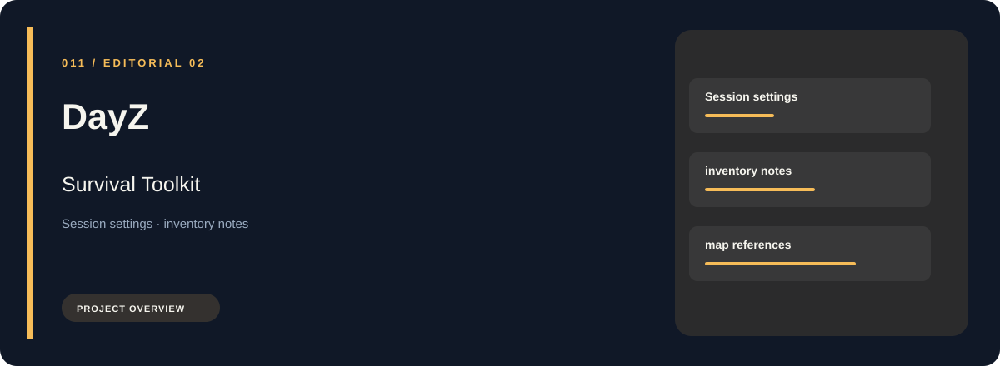
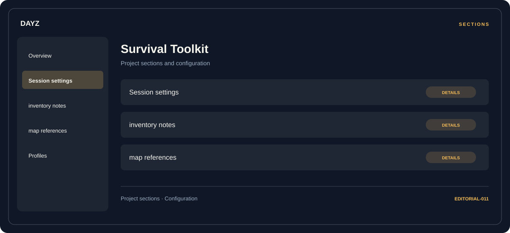

# 🧭 DayZ Survival Toolkit

**Session settings · Inventory notes · Map references**

## ⚡ Features

DayZ Survival Toolkit groups session settings, inventory notes, and map references in a single workspace. Each section keeps its controls and related settings together.

### ⚙️ Session settings

Session and activity information grouped by the task or context it belongs to.

### 🧩 Inventory notes

Inventory and resource categories organized alongside their related values and notes.

### ⌨️ Map references

A dedicated section for map references and the configuration details associated with that area.

## 🖥️ Project navigation

## 📥 Download

The button and cover open the project's download page. Use the information supplied with the downloaded package for installation and release-specific requirements.

## 📚 Project documentation

- [Feature reference](docs/FEATURES.md)
- [Download information](docs/DOWNLOAD.md)
- [Project page](index.html)

---

DayZ Survival Toolkit · Program documentation and download information.
